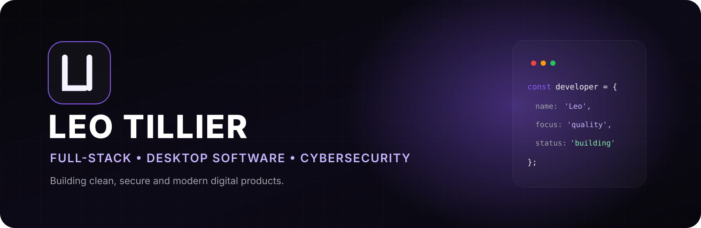
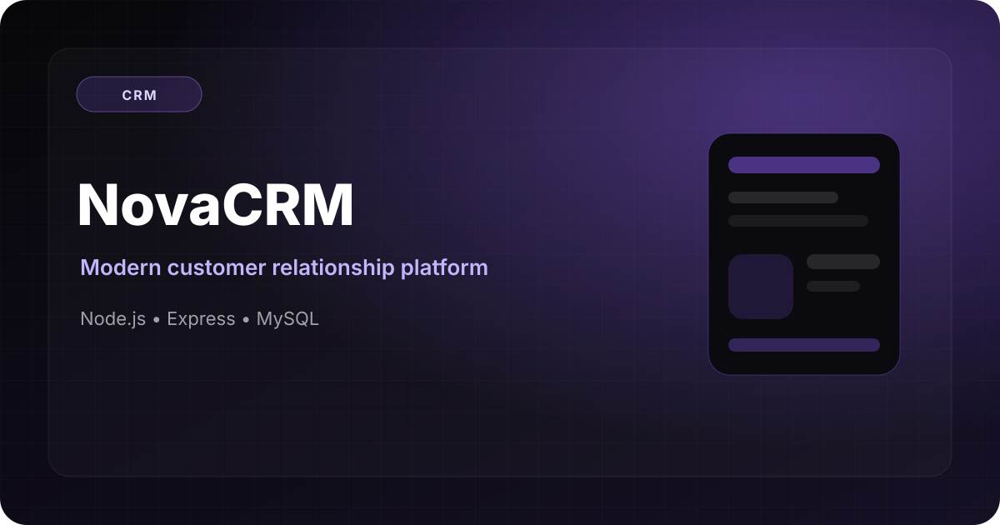
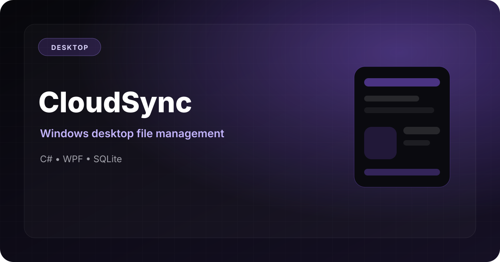
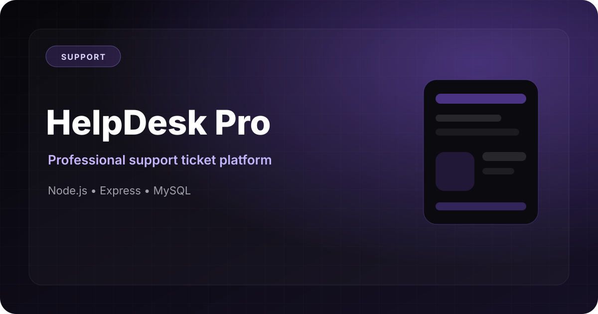
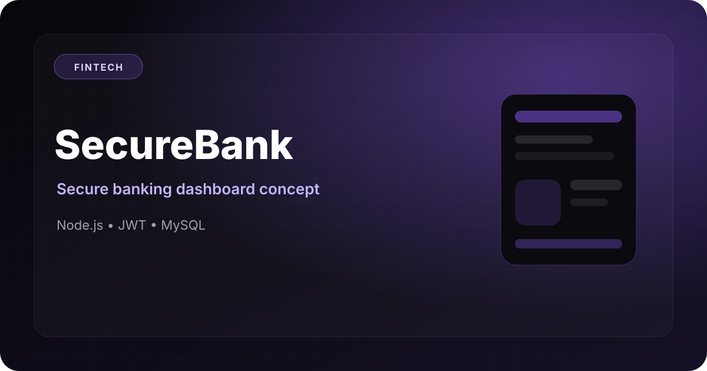
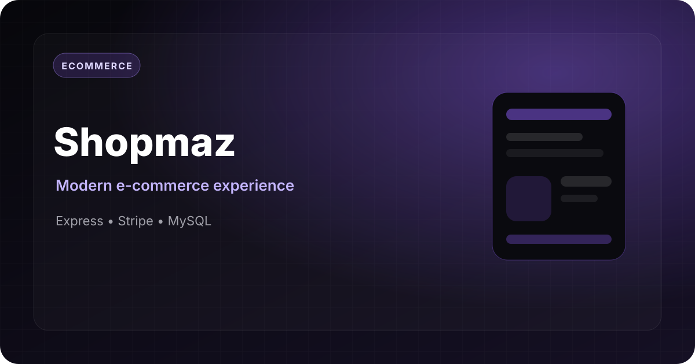

 

  

---

## About me

I am a French developer focused on building **modern web applications**, **Windows desktop software**, and **secure backend systems**.

I care about clean architecture, thoughtful interfaces, performance, maintainability, and honest project documentation.

- Full-stack web development
- Windows desktop applications
- REST APIs and database design
- Secure development practices
- Modern and responsive user interfaces
- Performance and code-quality improvements

---

## Tech stack

### Languages

### Frameworks and runtime

### Data and tools

---

## Featured projects

<table>
<tr><td width="50%" valign="top">

### NovaCRM

A modern customer relationship management platform designed around clear workflows, customer records and business visibility.

**Stack:** Node.js, Express, MySQL, JavaScript

[View repository](#)

</td><td width="50%" valign="top">

### CloudSync

A Windows desktop application concept for file organization, synchronization and local data management.

**Stack:** C#, .NET, WPF, SQLite

[View repository](#)

</td></tr>
<tr><td width="50%" valign="top">

### HelpDesk Pro

A support-ticket platform for managing requests, priorities, statuses and team workflows.

**Stack:** Node.js, Express, MySQL

[View repository](#)

</td><td width="50%" valign="top">

### SecureBank

A banking-dashboard concept focused on authentication, account visibility and secure user flows.

**Stack:** Node.js, JWT, MySQL

[View repository](#)

</td></tr>
<tr><td width="50%" valign="top">

### Shopmaz

A responsive e-commerce experience featuring products, cart flows and online-payment integration concepts.

**Stack:** Express, Stripe, MySQL

[View repository](#)

</td><td width="50%" valign="top">

### Security Audit Dashboard

A vulnerability-management dashboard concept for organizing findings, severity levels and remediation progress.

**Stack:** Python, Flask, SQLite

[View repository](#)

</td></tr>
</table>

> Replace every `#` link above with the matching repository URL after publishing each project.

---

## Certifications

| Certification | Provider |
|---|---|
| Introduction to Cybersecurity | Cisco Networking Academy |
| Ethical Hacker | Cisco Networking Academy |
| Networking Basics | Cisco Networking Academy |
| Python Essentials | Cisco Networking Academy |
| Cyber Threat Management | Cisco Networking Academy |
| Network Defense | Cisco Networking Academy |
| SecNum Académie | ANSSI |

---

## GitHub analytics

 

 

 

---

## Contact

**Portfolio:** [leo-tillier.fr](https://snyzz-dev.github.io/leo-tillier/)  
**Email:** [snyzzoff@gmail.com](mailto:snyzzoff@gmail.com)  
**Fiverr:** [View my freelance profile](https://fr.fiverr.com/s/BR5g98W)  
**GitHub:** [Snyzz-dev](https://github.com/Snyzz-dev)

---

### Thanks for visiting.

*Clean code. Modern design. Secure software.*

